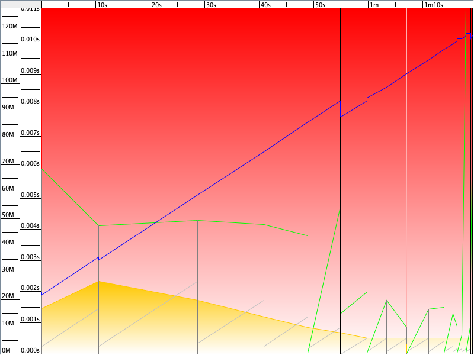
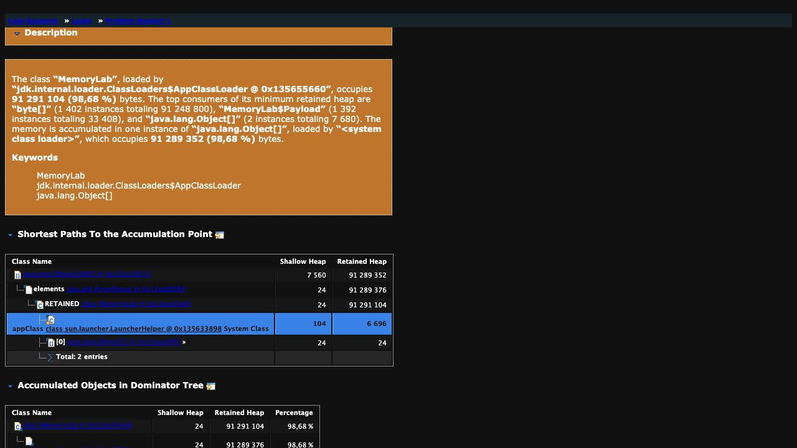

# Работа GC и управление памятью

## Код и запуск нагрузки

В [MemoryLab.java](../src/MemoryLab.java) реализована утечка: статическая коллекция `ArrayDeque<Payload> RETAINED` сохраняет объекты с массивами `byte[65536]`. Поток `payload-allocator` добавляет восемь объектов каждые 400 мс — около 1,25 МиБ/с. Daemon-поток `heap-sampler` каждую секунду записывает размер коллекции, занятый heap и счётчики GC. Основной поток ожидает завершения через `join()`.

Stream API суммирует размеры массивов (`RETAINED.stream().mapToLong(...).sum()`) и счётчики GC MXBeans. Изменение и обход коллекции защищены одним `synchronized`. Режим `leak` сохраняет все объекты, исправленный режим `bounded` удаляет старые элементы и хранит не более 64.

Использованы Java 17.0.19, G1 GC, jstat, jcmd, GCViewer 1.37 и Eclipse MAT 1.17.0. Параметры JVM:

```text
-Xms128m -Xmx128m -XX:+UseG1GC -XX:+ExitOnOutOfMemoryError
-Xlog:gc*=info:file=gc.log:uptime,level,tags:filecount=0
```

[Скрипт эксперимента](../scripts/run_experiment.py) запускает два процесса с одинаковой нагрузкой и отдельными файлами `gc.log`. Утечка привела к OOM за **94,6 секунды**. Исправленный вариант проработал **120 секунд** без OOM.

## Анализ GC-логов, jstat и GCViewer

Команда `jstat -gc -t PID 1000` снимает показатели каждую секунду. Анализировались занятая память Eden (`EU`) и old generation (`OU`), число молодых и полных сборок (`YGC`, `FGC`), время GC (`GCT`). В логах сравнивалась память до и после сборки:

```text
leak, 70.221s: Pause Full (Heap Dump Initiated GC) 94M->88M(128M) 4.752ms
leak, 94.561s: Pause Full (G1 Compaction Pause) 118M->118M(128M) 4.260ms
bounded, 45.687s: Pause Young (Normal) (G1 Evacuation Pause) 45M->7M(128M) 2.432ms
bounded, 70.573s: Pause Full (Heap Dump Initiated GC) 40M->5M(128M) 3.832ms
```

При утечке освобождаются временные объекты, но удерживаемые коллекцией данные остаются. Перед OOM полная сборка уже не снижает занятость: `118M→118M`. В исправленном варианте после Full GC остаётся около 5 МиБ.

| Показатель | Утечка | Ограниченная коллекция |
|---|---:|---:|
| Завершение | OOM, около 94,6 с | Нормально, 120,355 с |
| Максимум объектов в секундных выборках | 1 856 | 64 |
| Максимальный измеренный used heap | 118,85 МиБ | 69,40 МиБ |
| OU в последней выборке jstat | 121 723,8 КиБ | 5 524,7 КиБ |
| YGC / FGC | 16 / 5 | 2 / 2 |
| Все stop-the-world паузы | 33 | 4 |
| Суммарная длительность пауз | 68,061 мс | 10,203 мс |
| Максимальная пауза | 11,118 мс | 3,832 мс |

Две Full GC в каждом режиме вызваны диагностикой — снятием дампа и гистограммы. В утечке дополнительно произошло три Full GC из-за нехватки памяти. Общее число пауз также включает G1 Remark/Cleanup.


График построен по [измерениям утечки](../results/leak/heap.csv) и [контрольного режима](../results/bounded/heap.csv). В `bounded` коллекция удерживает 4 МиБ массивов; временный рост used heap связан с объектами, ожидающими следующей сборки. В `leak` растут и heap, и объём удерживаемых данных.

Оба лога обработаны GCViewer в CLI: получены [сводка утечки](../results/leak/gcviewer.csv), [контрольная сводка](../results/bounded/gcviewer.csv) и график. Длительности пауз сверены с исходными логами.



Уровень памяти после сборок растёт, а в конце сборки учащаются и перестают освобождать место для новых объектов.

## Heap dump и Eclipse MAT

На 70-й секунде выполнена команда `jcmd PID GC.heap_dump heap.hprof`. Размер файла с утечкой — 95 250 657 байт, контрольного — 8 192 903 байта. Дампы проанализированы Eclipse MAT в пакетном режиме `org.eclipse.mat.api:suspects`.

MAT выявил удержание классом `MemoryLab` **91 291 104 байт — 98,68% живых объектов дампа**. Коллекция содержит **1392 объекта Payload**. Shallow heap одного Payload — 24 байта, retained heap с массивом — около 65 576 байт. Путь к GC Roots объясняет удержание:

```text
sun.launcher.LauncherHelper
  → appClass: class MemoryLab
    → static RETAINED: java.util.ArrayDeque
      → elements: java.lang.Object[]
        → MemoryLab$Payload
          → bytes: byte[]
```



В контрольном дампе осталось **64 Payload**, retained heap класса — **4 198 928 байт**. MAT также относит класс к Leak Suspects из-за большой доли в небольшом дампе, но размер коллекции ограничен и больше не растёт. [Отчёт MAT об утечке](../results/leak/heap_Leak_Suspects.zip), [контрольный отчёт](../results/bounded/heap_Leak_Suspects.zip).

## Вывод

Причина утечки — сильные ссылки из статической коллекции на уже ненужные объекты. Ограничение коллекции до 64 элементов и удаление старых ссылок устранили накопление: при той же нагрузке приложение завершило двухминутный запуск без OOM. Увеличение `-Xmx` только отсрочит переполнение; `System.gc()` не освободит достижимые объекты.
