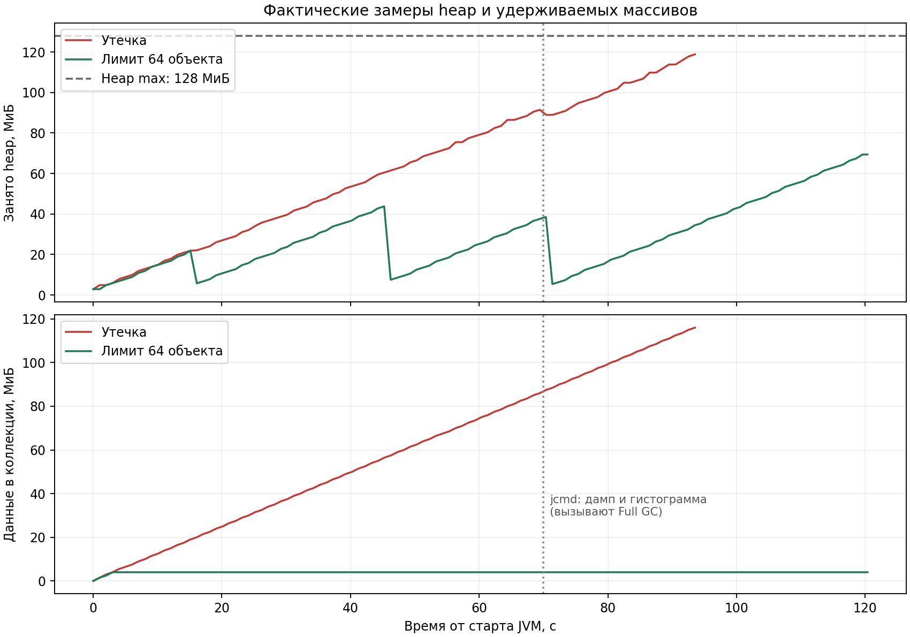
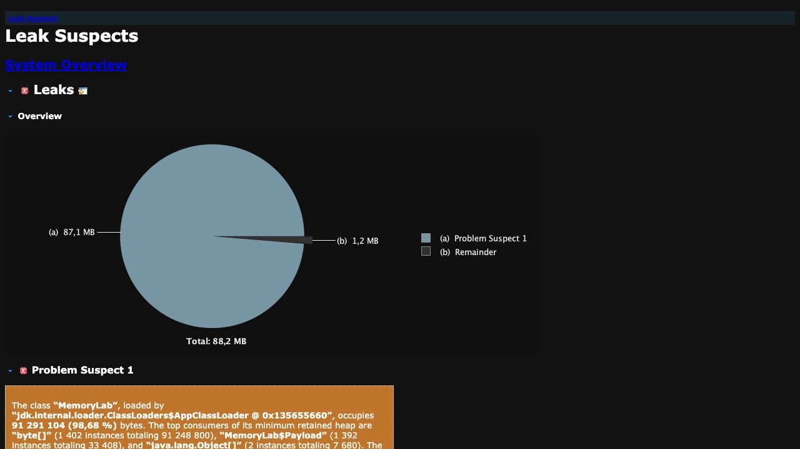

# Отчёт: работа GC и управление памятью

**Дисциплина:** Управление производительностью приложений. **Домашнее задание по теме 2.**

**Дата эксперимента:** 20 ноября 2026 года.

## Цель и условия

Воспроизвести утечку через статическую коллекцию, показать невозможность освобождения достижимых объектов сборщиком мусора и проверить исправление. Использованы Java 17.0.19 (Amazon Corretto), HotSpot G1, GC Logging, jstat, jcmd, GCViewer 1.37 и Eclipse MAT 1.17.0. MAT запускался на Java 25.0.2. ОС — macOS 27.2.1, архитектура ARM64.

Два отдельных процесса JVM получали одинаковую синтетическую нагрузку: восемь массивов по 64 КиБ каждые 400 мс, целевая скорость выделения — 1,25 МиБ/с. Heap каждого процесса ограничен 128 МиБ. Режим `leak` сохраняет все объекты, `bounded` — только последние 64. Процессы работали одновременно; это демонстрация поведения памяти, а не изолированный бенчмарк скорости GC.

## 1. Код, потоки и Stream API

В [MemoryLab.java](../src/MemoryLab.java) статический `ArrayDeque<Payload> RETAINED` хранит объекты `Payload`, каждый из которых содержит `byte[65536]` и порядковый номер.

Основной поток создаёт и запускает `payload-allocator` и `heap-sampler`, затем ожидает их через `join()`. Первый поток создаёт объекты и добавляет их в коллекцию. Второй является daemon-потоком и каждую секунду записывает CSV: время, количество объектов, суммарный размер массивов, занятый heap, число и время сборок. Stream API используется для `RETAINED.stream().mapToLong(...).sum()` и суммирования счётчиков GC MXBeans. Обход коллекции и её изменение выполняются под одним `synchronized`, поэтому измерение не вызывает конкурентной модификации.

В режиме утечки обработанные объекты больше не нужны приложению, но ссылки на них остаются. В контрольном режиме перед добавлением 65-го элемента удаляется самый старый. Удалённый объект становится доступным для GC после исчезновения остальных ссылок. Лимит 64 выбран как модель хранения последних результатов; в реальной системе политика удаления должна соответствовать требованиям к данным.

## 2. Логирование и нагрузка

Использованные параметры JVM:

```text
-Xms128m -Xmx128m -XX:+UseG1GC -XX:+ExitOnOutOfMemoryError
-Xlog:gc*=info:file=gc.log:uptime,level,tags:filecount=0
```

`gc.log` создаётся в отдельной папке каждого запуска. Фиксированный heap упрощает сравнение, G1 выбран явно. `ExitOnOutOfMemoryError` обеспечивает завершение процесса при OOM, а не исправление причины. Нагрузка реализована циклом в отдельном потоке; внешние данные не используются.

Автоматизация: [run_experiment.py](../scripts/run_experiment.py). Сохраняются исходные ответы инструментов; на 70-й секунде снимаются дампы обоих процессов. **Режим утечки достиг OOM примерно за 94,6 секунды**, то есть за требуемые 1–2 минуты. Контрольный режим завершил 120 секунд с кодом 0. [Параметры и коды завершения](../results/experiment.json).

## 3. Что показали GC-логи и jstat

Диагностика выполнялась командой `jstat -gc -t PID 1000`. Анализировались `EU` (занятая Eden), `OU` (занятая old generation), `YGC`, `FGC`, `GCT`. Значения памяти jstat выражены в КиБ. В логе GC сравнивались значения heap до и после паузы; особенно важен уровень **после** полной сборки.

Характерные строки исходных логов:

```text
leak, 70.221s: Pause Full (Heap Dump Initiated GC) 94M->88M(128M) 4.752ms
leak, 94.561s: Pause Full (G1 Compaction Pause) 118M->118M(128M) 4.260ms
leak, 94.563s: Pause Full (G1 Compaction Pause) 118M->118M(128M) 2.556ms
bounded, 15.792s: Pause Young (Normal) (G1 Evacuation Pause) 23M->5M(128M) 2.861ms
bounded, 45.687s: Pause Young (Normal) (G1 Evacuation Pause) 45M->7M(128M) 2.432ms
bounded, 70.573s: Pause Full (Heap Dump Initiated GC) 40M->5M(128M) 3.832ms
```

GC способен освобождать временные объекты даже при утечке: например, `94M→88M`. Но основной объём остаётся достижимым, и уровень после сборки продолжает расти. В конце повторные Full GC не снижают занятость: `118M→118M`. OOM возникает до арифметических 128 МиБ: свободных областей и возможности очередного выделения/эвакуации G1 уже недостаточно. Показатели heap в строках округлены до целых МиБ.

| Показатель | Утечка | Ограниченная коллекция |
|---|---:|---:|
| Завершение | OOM, код 3, около 94,6 с | Нормально, код 0, 120,355 с |
| Максимум объектов в секундных выборках | 1 856 | 64 |
| Максимальный измеренный used heap | 118,85 МиБ | 69,40 МиБ |
| OU в последней выборке jstat | 121 723,8 КиБ | 5 524,7 КиБ |
| YGC / FGC в jstat | 16 / 5 | 2 / 2 |
| Все stop-the-world паузы в GC-логе | 33 | 4 |
| Суммарная длительность этих пауз | 68,061 мс | 10,203 мс |
| Максимальная пауза | 11,118 мс | 3,832 мс |

33 паузы не равны `YGC + FGC`: сюда входят также G1 Remark/Cleanup. Две Full GC в **каждом** режиме вызваны диагностикой (`GC.heap_dump`, `GC.class_histogram`), а не нехваткой памяти. В утечке дополнительно произошли три Full GC из-за давления на heap. Небольшое отличие суммы пауз от `GCT` связано с составом счётчиков и округлением; анализ использует соответствующие метрики отдельно.



График построен из реальных [leak/heap.csv](../results/leak/heap.csv) и [bounded/heap.csv](../results/bounded/heap.csv) через Matplotlib; это **не скриншот VisualVM**. Рост used heap между сборками нормален. У контрольного режима массивы в коллекции стабильно занимают 4 МиБ, хотя к концу опыта used heap достиг 69,40 МиБ: многие уже недостижимые объекты ещё ждут следующей сборки. У утечки растут и heap, и удерживаемые данные.

## 4. Анализ в GCViewer

Оба `gc.log` обработаны **GCViewer 1.37** в режиме CLI, создан CSV SUMMARY и экспортирован график. Число и сумма пауз независимо сверены с исходными строками логов скриптом [analyze.py](../scripts/analyze.py). Ошибок разбора в журнале GCViewer не обнаружено.


Синяя линия used heap растёт; уровень после Full GC не возвращается к исходному. В конце сборки сгущаются. [Экспорт GCViewer с утечкой](../results/leak/gcviewer.csv), [контрольный экспорт](../results/bounded/gcviewer.csv), [контрольный график](images/gcviewer-bounded.png).

GCViewer показал `throughput` 99,91% и 99,98%. Здесь это оценка доли времени вне учитываемых GC-пауз, **не запросы в секунду** и не гарантия отсутствия утечки. Для утечки GCViewer показывает около 79 секунд между первым и последним GC, а весь процесс работал около 94,6 секунды. На экспортированном графике время отсчитывается от первого события. Малое суммарное время GC в этом опыте не отменяет отказ из-за OOM; длительную «GC-лавину» этот опыт не демонстрирует.

## 5. Heap dump и Eclipse MAT

Около 70-й секунды выполнены `jcmd PID GC.heap_dump heap.hprof`, затем `GC.class_histogram` и `GC.heap_info`. Дамп с утечкой занимает **95 250 657 байт**, контрольный — **8 192 903 байта**. Размер HPROF на диске не равен occupied heap или retained heap. [Подтверждение jcmd: leak](../results/leak/heap-dump.txt), [bounded](../results/bounded/heap-dump.txt), [хеши дампов](../results/dump-sha256.txt).

Оба дампа разобраны **Eclipse MAT 1.17.0** в официальном пакетном режиме с отчётом `org.eclipse.mat.api:suspects`. Ниже — настоящие скриншоты HTML-отчёта, сформированного MAT и открытого в браузере. Анализ в VisualVM для итоговых выводов не использовался.



MAT определил `MemoryLab` как главный источник удержания: **91 291 104 байта, 98,68% живых объектов дампа**. Через статическую коллекцию удерживаются **1 392 объекта Payload**. Каждый Payload имеет shallow heap 24 байта, но retained heap примерно 65 576 байт с учётом массива. Одна гистограмма shallow heap могла бы отвлечь внимание на `byte[]`; дерево доминаторов и пути к GC Roots объясняют, кто сохраняет ссылки.


Путь из таблицы MAT читается от корня к накопленным данным так:

```text
System Class: sun.launcher.LauncherHelper
  → appClass: class MemoryLab
    → static RETAINED: java.util.ArrayDeque
      → elements: java.lang.Object[]
        → MemoryLab$Payload
          → bytes: byte[]
```

Статическая ссылка удерживает объекты на всём протяжении работы приложения. GC действует правильно: он не должен удалять достижимые объекты. В гистограмме jcmd уже **1 400 Payload**, поскольку она снята немного позже дампа и генератор продолжал работу. Это разные моменты времени, а не противоречие инструментов.

В контрольном дампе MAT показывает **64 Payload**, а retained heap `MemoryLab` — **4 198 928 байт**. MAT всё равно включает класс в Leak Suspects (77,10% маленького дампа). Это эвристика большого удержания, а не доказательство утечки: ограниченный размер коллекции и временной ряд подтверждают отсутствие её неограниченного роста в проверенном сценарии.

Полные отчёты для скачивания и открытия `index.html` после распаковки: [MAT — утечка](../results/leak/heap_Leak_Suspects.zip), [MAT — контроль](../results/bounded/heap_Leak_Suspects.zip). Сырые HPROF сохранены локально; в Git размещены отчёты и команды воспроизведения.

## 6. Исправление и выводы

Причина проблемы — неограниченное удержание ненужных объектов статической коллекцией. В контрольном варианте ограничение до 64 элементов и удаление старых ссылок устраняют накопление: после диагностического Full GC остаётся около 5 МиБ общего heap, и приложение выдерживает 120 секунд той же нагрузки без OOM.

Для реального приложения возможны ограниченный кэш с eviction/TTL, своевременное удаление обработанных записей, очистка слушателей и ThreadLocal при завершении их жизненного цикла. Нужно выбирать политику по требованиям к данным. Увеличение `-Xmx` только отсрочит переполнение при неизменной утечке; `System.gc()` не освободит объекты, на которые остались сильные ссылки.

Опыт подтверждает причину утечки сочетанием трёх наблюдений: роста удерживаемых данных, высокого уровня heap после Full GC и цепочки сильных ссылок в MAT. Проверка ограничена двумя минутами и синтетическими массивами; задержки зависят от JVM, нагрузки компьютера и диагностических остановок.

## Самопроверка

- [x] Исходный код с потоками, Stream API и искусственной утечкой.
- [x] Включены GC-логи; нагрузка заполнила heap за 1–2 минуты.
- [x] Выполнен анализ jstat и GCViewer.
- [x] Сгенерированы heap dump командой jcmd.
- [x] Оба дампа проанализированы Eclipse MAT, найдены доминатор и путь к GC Roots.
- [x] Проверено исправление; сохранены исходные данные, графики и отчёт.
- [ ] Ссылку на отчёт нужно самостоятельно прикрепить в личном кабинете курса.

## Документация инструментов

- [Oracle: jstat](https://docs.oracle.com/en/java/javase/17/docs/specs/man/jstat.html) — значения счётчиков и единицы измерения.
- [Oracle: jcmd](https://docs.oracle.com/en/java/javase/17/docs/specs/man/jcmd.html) — команды диагностики и heap dump.
- [GCViewer](https://github.com/chewiebug/GCViewer) — поддерживаемые логи и экспорт анализа.
- [Eclipse MAT: batch mode](https://help.eclipse.org/latest/topic/org.eclipse.mat.ui.help/tasks/batch.html) — создание Leak Suspects без интерактивного интерфейса.
